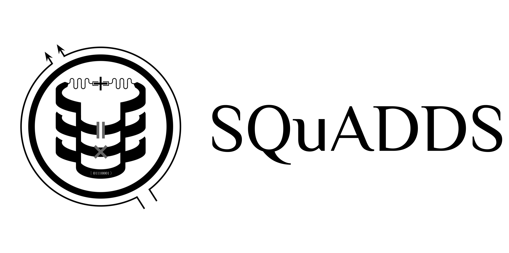

<center>
  
</center>

# Superconducting Qubit And Device Design and Simulation Database     [](https://arxiv.org/abs/2312.13483) [](https://deepwiki.com/LFL-Lab/SQuADDS)

The SQuADDS (Superconducting Qubit And Device Design and Simulation) Database Project is an open-source resource aimed at advancing research in superconducting quantum device designs. It provides a robust workflow for generating and simulating superconducting quantum device designs, facilitating the accurate prediction of Hamiltonian parameters across a wide range of design geometries.

SQuADDS also predicts the full Maxwell capacitance matrix of any planar superconducting circuit layout straight from its GDS file. The models behind this are physics-corrected graph neural networks trained on our Q3D dataset, and they run on your own machine in about a second per layout.

**Paper Link:** [SQuADDS: A Database for Superconducting Quantum Device Design and Simulation](https://quantum-journal.org/papers/q-2024-09-09-1465/)

**Capacitance Paper Link:** [QCap: a physics-corrected graph neural network for the capacitance matrix of any planar superconducting device layout](https://lfl-lab.github.io/SQuADDS/ml-paper/paper/)

**Capacitance Paper Page:** [https://lfl-lab.github.io/SQuADDS/qcap/](https://lfl-lab.github.io/SQuADDS/qcap/), with the explainer videos and the tutorials

**Docsite Link:** [https://lfl-lab.github.io/SQuADDS/](https://lfl-lab.github.io/SQuADDS/)

**Hugging Face Links:** [SQuADDS database](https://huggingface.co/datasets/SQuADDS/SQuADDS_DB), [planar capacitance dataset](https://huggingface.co/datasets/SQuADDS/SQuADDS_PlanarCapacitance), [planar capacitance models](https://huggingface.co/SQuADDS/QCap), [all SQuADDS models](https://huggingface.co/collections/SQuADDS/squadds-models-6af8b7da67a22df62af374c6)

**Browser Demo:** [https://huggingface.co/spaces/SQuADDS/planar-capacitance](https://huggingface.co/spaces/SQuADDS/planar-capacitance) (upload a GDS, get its capacitance matrix)

**Contribution Portal Link:** [https://squadds-portal.vercel.app](https://squadds-portal.vercel.app)

**Chat with the Codebase:** [https://deepwiki.com/LFL-Lab/SQuADDS/1-overview](https://deepwiki.com/LFL-Lab/SQuADDS/1-overview)

## Table of Contents

- [Citation](#citation)
- [Installation](#installation)
  - [Install from Source](#install-from-source-recommended-for-development)
  - [Install using pip](#install-using-pip)
  - [Run using Docker](#run-using-docker)
- [Tutorials](#tutorials)
- [MCP Server (AI Agent Integration)](#mcp-server-ai-agent-integration)
- [ML Models](#ml-models)
- [Contributing](#contributing)
- [License](#license)
- [FAQs](#faqs)
- [Contact](#contact)
- [Contributors](#contributors)
- [Developers](#developers)

---

## Citation

If SQuADDS helps your research, please support its continued development and maintenance by citing the paper: [Shanto et al., Quantum 8, 1465 (2024)](https://doi.org/10.22331/q-2024-09-09-1465). If you use QCap (the planar capacitance models or their dataset), please also cite [Shanto, Das and Levenson-Falk (2026)](https://lfl-lab.github.io/SQuADDS/ml-paper/paper/).

```bibtex
@article{Shanto2024squaddsvalidated,
  doi = {10.22331/q-2024-09-09-1465},
  url = {https://doi.org/10.22331/q-2024-09-09-1465},
  title = {{SQ}u{ADDS}: {A} validated design database and simulation workflow for superconducting qubit design},
  author = {Shanto, Sadman and Kuo, Andre and Miyamoto, Clark and Zhang, Haimeng and Maurya, Vivek and Vlachos, Evangelos and Hecht, Malida and Shum, Chung Wa and Levenson-Falk, Eli},
  journal = {{Quantum}},
  issn = {2521-327X},
  publisher = {{Verein zur F{\"{o}}rderung des Open Access Publizierens in den Quantenwissenschaften}},
  volume = {8},
  pages = {1465},
  month = sep,
  year = {2024}
}

@misc{Shanto2026planarcapacitance,
  title = {{QCap}: a physics-corrected graph neural network for the capacitance matrix of any planar superconducting device layout},
  author = {Shanto, Sadman Ahmed and Das, Saikat and Levenson-Falk, Eli},
  year = {2026},
  url = {https://lfl-lab.github.io/SQuADDS/ml-paper/paper/}
}
```

---

## Installation

SQuADDS needs Python 3.11 or newer (we test 3.11, 3.12 and 3.13). It uses [uv](https://docs.astral.sh/uv/) for fast, reliable Python package management.

### Prerequisites

Install `uv` (if you don't have it already):

```bash
curl -LsSf https://astral.sh/uv/install.sh | sh
```

### Install from Source (Recommended for Development)

```bash
git clone https://github.com/LFL-Lab/SQuADDS.git
cd SQuADDS
uv sync
```

Verify the installation:

```bash
uv run python -c "import squadds; print(squadds.__file__)"
```

### Install using pip

```bash
pip install SQuADDS
```

### Optional Dependencies

Install GDS processing tools:

```bash
uv sync --extra gds
```

Install the planar capacitance models (PyTorch, gdstk and the physics prior):

```bash
uv sync --extra ml
```

or, with pip:

```bash
pip install "squadds[ml]"
```

Install documentation tools:

```bash
uv sync --extra docs
```

Install development tools:

```bash
uv sync --extra dev
```

Install contribution tools (for contributing data to SQuADDS):

```bash
uv sync --extra contrib
```

Install all optional dependencies:

```bash
uv sync --all-extras
```

### Setting up Jupyter Notebook

To use SQuADDS in Jupyter notebooks (including VS Code/Cursor), register the kernel:

```bash
uv sync --extra dev  # Installs ipykernel
uv run python -m ipykernel install --user --name squadds --display-name "SQuADDS (uv)"
```

Then select **"SQuADDS (uv)"** as your kernel in Jupyter/VS Code/Cursor.

### Run using Docker:

<details>
<summary>Click to expand/hide Docker instructions</summary>
<br>

We provide a pre-built Docker image that contains all dependencies, including `Qiskit-Metal` and the latest `SQuADDS` release.

#### Pull the Latest Docker Image

You can pull the latest image of **SQuADDS** from GitHub Packages:

```bash
docker pull ghcr.io/lfl-lab/squadds_env:latest
```

If you'd like to pull a specific version (support begins from `v0.3.4` onwards), use the following command:

```bash
docker pull ghcr.io/lfl-lab/squadds_env:v0.3.4
```

You can find all available versions and tags for the **squadds_env** Docker image on [LFL-Lab Packages](https://github.com/LFL-Lab?tab=packages&repo_name=SQuADDS).

#### Run the Docker Container

After pulling the image, you can run the container using:

```bash
docker run -it ghcr.io/lfl-lab/squadds_env:latest /bin/bash
```

This will give you access to a bash shell inside the container.

#### Activate the Conda Environment

Inside the container, activate the `squadds-env` environment:

```bash
conda activate squadds-env
```

#### Run SQuADDS

Once the environment is active, you can run **SQuADDS** by executing your Python scripts or starting an interactive Python session.

</details>

---

## Tutorials

The following tutorials are available to help you get started with `SQuADDS`:

- [Tutorial 0: Using the SQuADDS WebUI](https://lfl-lab.github.io/SQuADDS/source/tutorials/Tutorial-0_Using_the_SQuADDS_WebUI.html)
- [Tutorial 1: Getting Started with SQuADDS](https://lfl-lab.github.io/SQuADDS/source/tutorials/Tutorial-1_Getting_Started_with_SQuADDS.html)
- [Tutorial 2: Simulating Interpolated Designs](https://lfl-lab.github.io/SQuADDS/source/tutorials/Tutorial-2_Simulate_interpolated_designs.html)
- [Tutorial 3: Contributing Experimentally-Validated Simulation Data to the SQuADDS Database](https://lfl-lab.github.io/SQuADDS/source/tutorials/Tutorial-3_Contributing_Validated_Simulation_Data_to_SQuADDS.html)
- [Tutorial 4: Contributing Measured Devices' Data to the SQuADDS Database](https://lfl-lab.github.io/SQuADDS/source/tutorials/Tutorial_4_Contributing_Measured_Data_to_SQuADDS.html)
- [Tutorial 5: Designing a "fab-ready" chip with SQuADDS](https://lfl-lab.github.io/SQuADDS/source/tutorials/Tutorial-5_Designing_a_fab_ready_chip_with_SQuADDS.html)
- [Tutorial 6: Adding Airbridges](https://lfl-lab.github.io/SQuADDS/source/tutorials/Tutorial-6_Adding_Airbridges.html)
- [Tutorial 7: Simulate designs with palace](https://lfl-lab.github.io/SQuADDS/source/tutorials/Tutorial-7_Simulate_designs_with_palace.html)
- [Tutorial 8: ML Interpolation in SQuADDS](https://lfl-lab.github.io/SQuADDS/source/tutorials/Tutorial-8_ML_interpolation_in_SQuADDS.html)
- [Tutorial 9: HFSS Driven-Modal Capacitance Extraction](https://lfl-lab.github.io/SQuADDS/source/tutorials/Tutorial-9_DrivenModal_Capacitance_Extraction.html)
- [Tutorial 10: Unified Driven-Modal Hamiltonian Extraction](https://lfl-lab.github.io/SQuADDS/source/tutorials/Tutorial-10_DrivenModal_Combined_Hamiltonian_Extraction.html)
- [Tutorial 11: Predicting Capacitance Matrices from a GDS](https://lfl-lab.github.io/SQuADDS/source/tutorials/Tutorial-11_Predicting_Capacitance_Matrices_from_GDS.html)
- [Tutorial 12: Planar Capacitance Families in SQuADDS](https://lfl-lab.github.io/SQuADDS/source/tutorials/Tutorial-12_Planar_Capacitance_Families_in_SQuADDS.html)
- [Tutorial 13: From Layout to Hamiltonian with ML](https://lfl-lab.github.io/SQuADDS/source/tutorials/Tutorial-13_From_Layout_to_Hamiltonian_with_ML.html)
- [Tutorial 14: Training on Your Own Designs](https://lfl-lab.github.io/SQuADDS/source/tutorials/Tutorial-14_Training_on_Your_Own_Designs.html)
- [Tutorial 15: Contributing Capacitance Data and Models](https://lfl-lab.github.io/SQuADDS/source/tutorials/Tutorial-15_Contributing_Capacitance_Data_and_Models.html)
- [Tutorial 16: Inverse Design by ML Screening](https://lfl-lab.github.io/SQuADDS/source/tutorials/Tutorial-16_Inverse_Design_by_ML_Screening.html)

---

## MCP Server (AI Agent Integration)

SQuADDS includes a built-in **Model Context Protocol (MCP)** server that lets AI coding agents interact with the entire database — searching designs, interpolating parameters, and exploring components — through a standardized protocol.

### Agent Setup (Copy-Paste This to Your AI Agent)

> **If you're using an AI coding assistant**, just paste this prompt to have it set up SQuADDS MCP for you:

<details>
<summary><strong>Click to copy the agent setup prompt</strong></summary>

```
I need you to set up the SQuADDS MCP server so I can access the superconducting
qubit design database through you. Here's what to do:

1. Clone the repo and install:
   git clone https://github.com/LFL-Lab/SQuADDS.git
   cd SQuADDS
   uv sync --extra mcp --extra ml
   (drop `--extra ml` if you don't need the planar capacitance models)

2. Add the MCP server to your config. The command to run the server is:
   uv run --directory /path/to/SQuADDS squadds-mcp

3. Once connected, read the `squadds://guide` resource for a quick overview
   of available tools.

The server exposes these key tools:
- `list_components` / `list_datasets` — explore the database
- `find_closest_designs` — find designs matching target Hamiltonian parameters
- `interpolate_design` — get physics-interpolated designs
- `get_hamiltonian_param_keys` — discover valid search parameters
- `predict_capacitance_from_gds` — full Maxwell capacitance matrix of a GDS layout
  (read `squadds://planar-capacitance-guide` first)
- `capacitance_to_hamiltonian` — E_C, qubit frequency, anharmonicity and g from a matrix
- `query_planar_capacitance` / `nearest_planar_capacitance_designs` — the planar
  capacitance dataset
- `list_hosted_ml_models` / `predict_with_hosted_ml_model` — models on the hosted API

Typical target parameter ranges:
- qubit_frequency_GHz: 3–8
- anharmonicity_MHz: −500 to −50
- cavity_frequency_GHz: 5–12
- kappa_kHz: 10–1000
- g_MHz: 10–200

Please set this up and confirm you can access the SQuADDS tools.
```

</details>

### Manual Setup

#### Install

```bash
git clone https://github.com/LFL-Lab/SQuADDS.git
cd SQuADDS
uv sync --extra mcp
```

#### Run

```bash
# stdio mode (for local AI assistants)
uv run squadds-mcp

# HTTP mode (for networked/remote usage)
SQUADDS_MCP_TRANSPORT=streamable-http uv run squadds-mcp
```

#### Connect Your AI Client

<details>
<summary><strong>Claude Desktop</strong></summary>

Add to `claude_desktop_config.json`:
```json
{
  "mcpServers": {
    "squadds": {
      "command": "uv",
      "args": ["run", "--directory", "/path/to/SQuADDS", "squadds-mcp"]
    }
  }
}
```
</details>

<details>
<summary><strong>Claude Code</strong></summary>

```bash
claude mcp add squadds -- uv run --directory /path/to/SQuADDS squadds-mcp
```
</details>

<details>
<summary><strong>Cursor</strong></summary>

Add to `.cursor/mcp.json` in your project:
```json
{
  "mcpServers": {
    "squadds": {
      "command": "uv",
      "args": ["run", "--directory", "/path/to/SQuADDS", "squadds-mcp"]
    }
  }
}
```
</details>

<details>
<summary><strong>VS Code (Copilot)</strong></summary>

Add to `.vscode/settings.json`:
```json
{
  "mcp": {
    "servers": {
      "squadds": {
        "command": "uv",
        "args": ["run", "--directory", "/path/to/SQuADDS", "squadds-mcp"]
      }
    }
  }
}
```
</details>

<details>
<summary><strong>Antigravity (Gemini)</strong></summary>

Add to `~/.gemini/settings.json` (or project-level `.gemini/settings.json`):
```json
{
  "mcpServers": {
    "squadds": {
      "command": "uv",
      "args": ["run", "--directory", "/path/to/SQuADDS", "squadds-mcp"]
    }
  }
}
```
</details>

<details>
<summary><strong>Gemini CLI</strong></summary>

Add to `~/.gemini/settings.json`:
```json
{
  "mcpServers": {
    "squadds": {
      "command": "uv",
      "args": ["run", "--directory", "/path/to/SQuADDS", "squadds-mcp"]
    }
  }
}
```
</details>

<details>
<summary><strong>OpenAI Codex CLI</strong></summary>

```bash
codex --mcp-config mcp.json
```

With `mcp.json`:
```json
{
  "mcpServers": {
    "squadds": {
      "command": "uv",
      "args": ["run", "--directory", "/path/to/SQuADDS", "squadds-mcp"]
    }
  }
}
```
</details>

**Full MCP documentation:** [MCP_README.md](MCP_README.md) | **Developer guide:** [MCP_DEVELOPER_GUIDE.md](MCP_DEVELOPER_GUIDE.md)

---

## ML Models

SQuADDS has two groups of machine-learning models today: the planar capacitance models and the TransmonCross Hamiltonian-to-geometry model. Each is described below in the same order: what it does, how to run it locally and on our hosted API, its accuracy and time, and where to read more. The hosted API they share comes after both.

### Planar capacitance models (GDS -> Maxwell capacitance matrix)

#### What it does

Given a GDS layout, the model predicts the full N x N Maxwell capacitance matrix (fF, ground first) of every conductor in it. We infer the conductors from the layout and never merge nets, so N can be anything. A thin-film physics solve gives a first estimate, and graph neural networks trained on our Q3D dataset correct it. There are two models: `QCap` (the default) for accuracy and `QCap-Fast`, which skips the physics solve, for quick screening. They were built by Sadman Ahmed Shanto, Saikat Das and Eli Levenson-Falk.

#### Run it locally

```bash
pip install "squadds[ml]"
```

```python
from squadds.ml.capacitance import CapacitancePredictor, load_model

res = CapacitancePredictor(load_model("QCap")).predict("chip.gds")   # or "QCap-Fast"
res.names, res.matrix_fF, res.checks, res.timing_s     # also res.to_sim_results() for squadds.calcs
```

```bash
squadds-ml predict chip.gds                 # CSV matrix; --model QCap-Fast, --format json, --threads N
squadds-ml train --data shards/ --out runs/ --seeds 0,1,2   # retrain (paper recipe); --slurm job.sh writes an array script
```

It runs on a CPU and uses all your cores by default (`threads=` or `--threads` to limit), about a second per layout on a laptop. The package also gives you:

- the physics priors on their own: `physics_prior` and `optimized_physics_prior`
- the dataset: `PlanarCapacitanceDB`, also part of `SQuADDS_DB()` as the `planar_capacitance` source (`SQuADDS_DB(sources=("default",))` gives the original database alone)
- Q3D-shaped results inside the usual workflows: `MLSimulator` and `Analyzer.predict_capacitance`, from which the TransmonPocket and Xmon Hamiltonians follow
- retraining on your own designs: `fit_in_family` and `retrain_collective`
- contributing data and models: `validate_capacitance_contribution`, `contribute_capacitance` and `contribute_model`

#### Run it on the hosted API

```bash
curl -X POST https://squadds-squadds-ml-inference-api.hf.space/v1/models/qcap/predict \
  -F file=@chip.gds -F 'inputs={"ground_layer": "1/0", "conductor_layer": "1/10"}'
```

```python
from squadds.ml import client

res = client.predict("qcap", file="chip.gds")   # or "qcap-fast"
res["outputs"]["names"], res["outputs"]["matrix_fF"]
```

Or upload a GDS to the [browser demo](https://huggingface.co/spaces/SQuADDS/planar-capacitance).

<details>
<summary><strong>Inputs, outputs and limits</strong></summary>

- Input: the GDS file as the multipart field `file`, or base64 encoded in `inputs.file_base64` of a JSON body. The optional inputs are `ground_layer` and `conductor_layer` (`1/0` and `1/10` by default), the substrate's `eps_r` and `thickness_um` (11.45 and 350 µm), and `ground_pieces` when ground and conductors share a layer.
- Outputs: `names` (G first, then C1..Cn in file order), `matrix_fF` (the N x N Maxwell matrix in fF, ground first) and `sim_results` (the shape `SQuADDS_DB` uses).
- Limits: up to 70 conductors plus ground and 20 MB per file. The API runs on free, shared Hugging Face compute (two shared vCPUs, one prediction at a time), so large layouts take minutes. On your own machine the same models use all your cores and have no conductor limit, which is what we recommend.

</details>

#### Accuracy and time

| model | median error on a family it has never seen (MAE / RMSE) | time per layout (median, x86, 2 CPUs) |
|---|---|---|
| **`QCap`** (default) | 1.05 % (0.132 / 0.188 fF) | 0.845 s |
| `QCap-Fast` | 3.175 % (0.583 / 0.824 fF) | 0.091 s |

Both models are trained on all of our data. The error is the median relative error of the mutual capacitances on 39 layouts of a family that no part of either model saw in training (rings with a neighbour, 3 or 4 conductors). On that family `QCap-Fast` does worse than the physics prior alone, 1.765 % (0.275 / 0.376 fF), so use it only to screen the families it was trained on. The scores per family are in the [ML Models](https://lfl-lab.github.io/SQuADDS/source/ml_models.html#planar-capacitance-models) guide and the [paper](https://lfl-lab.github.io/SQuADDS/ml-paper/paper/).

#### Links

- Models: [SQuADDS/QCap](https://huggingface.co/SQuADDS/QCap)
- Dataset: [SQuADDS/SQuADDS_PlanarCapacitance](https://huggingface.co/datasets/SQuADDS/SQuADDS_PlanarCapacitance)
- Browser demo: [SQuADDS/planar-capacitance](https://huggingface.co/spaces/SQuADDS/planar-capacitance)
- Guide: [ML Models](https://lfl-lab.github.io/SQuADDS/source/ml_models.html#planar-capacitance-models), and Tutorials 11-16 above
- Paper: [QCap: a physics-corrected graph neural network for the capacitance matrix of any planar superconducting device layout](https://lfl-lab.github.io/SQuADDS/ml-paper/paper/), with explainer videos on the [paper page](https://lfl-lab.github.io/SQuADDS/qcap/)

### TransmonCross Hamiltonian-to-geometry model

#### What it does

Given a target qubit frequency and anharmonicity, the model returns the TransmonCross (qubit-claw) geometry that gives them: the claw length, the claw's ground spacing and the cross length, in meters. Feed those straight into SQuADDS / Qiskit Metal downstream flows. It was developed in collaboration with Taylor Patti, Nicola Pancotti, Enectali Figueroa-Feliciano, Sara Sussman, Abhishek Chakraborty, Olivia Seidel, Firas Abouzahr, Eli Levenson-Falk and Sadman Ahmed Shanto, with **Olivia Seidel and Firas Abouzahr** as the primary trainers.

#### Run it locally

The Keras checkpoint, its scalers and `inference_manifest.json` (input and output order, units) are in the model repo:

```bash
huggingface-cli download SQuADDS/transmon-cross-hamiltonian-inverse --local-dir transmon-cross-hamiltonian-inverse
```

#### Run it on the hosted API

```bash
curl -X POST \
  https://squadds-squadds-ml-inference-api.hf.space/v1/models/transmon_cross_hamiltonian_inverse/predict \
  -H 'Content-Type: application/json' \
  -d '{"inputs":{"qubit_frequency_GHz":4.85,"anharmonicity_MHz":-205.0}}'
```

```python
from squadds.ml import client

res = client.predict("transmon_cross_hamiltonian_inverse",
                     inputs={"qubit_frequency_GHz": 4.85, "anharmonicity_MHz": -205.0})
res["outputs"]["predictions"][0]                       # claw_length, ground_spacing, cross_length in meters
```

<details>
<summary><strong>Inputs, outputs and limits</strong></summary>

- Inputs: `qubit_frequency_GHz`, `anharmonicity_MHz`.
- Outputs (SI units, meters): `design_options.connection_pads.readout.claw_length`, `design_options.connection_pads.readout.ground_spacing`, `design_options.cross_length`.
- Full contract, sample response and manifest: the [model repo README](https://huggingface.co/SQuADDS/transmon-cross-hamiltonian-inverse) and the [Space README](https://huggingface.co/spaces/SQuADDS/squadds-ml-inference-api).

</details>

#### Accuracy and time

Its accuracy is reported in the [paper](https://arxiv.org/abs/2607.20795).

#### Links

- Paper: [Component-Level Inverse Design of Transmon Qubits Using Neural Networks](https://arxiv.org/abs/2607.20795) (Seidel et al., 2026)
- Model: [SQuADDS/transmon-cross-hamiltonian-inverse](https://huggingface.co/SQuADDS/transmon-cross-hamiltonian-inverse)
- Training data: the `qubit-TransmonCross-cap_matrix` configuration of [SQuADDS_DB](https://huggingface.co/datasets/SQuADDS/SQuADDS_DB)
- Guide: [ML Models](https://lfl-lab.github.io/SQuADDS/source/ml_models.html#hosted-inference-models)

### Hosted inference API

The SQuADDS ML inference API serves the models we host on our [Hugging Face org](https://huggingface.co/SQuADDS) over HTTP. It runs in the [SQuADDS ML Inference API Space](https://huggingface.co/spaces/SQuADDS/squadds-ml-inference-api) at <https://squadds-squadds-ml-inference-api.hf.space>. Every model sits behind the same routes:

| route | what it returns |
|---|---|
| `GET /v1/models` | the models you can call (id, family, `input_kind`, revision, status). This list is the source of truth for what is available |
| `GET /v1/models/{model_id}` | the model's contract: input and output names, units, limits, an example request |
| `GET /v1/models/{model_id}/schema` | the JSON schema of the request. `?format=tool` returns a tool definition for an AI agent (`name`, `description`, `input_schema`) |
| `POST /v1/models/{model_id}/predict` | the prediction: JSON `{"inputs": {...}, "options": {...}}`, or multipart (`file` + `inputs`) for models that take a file |
| `GET /v1/health`, `GET /docs`, `GET /openapi.json` | status, interactive docs, OpenAPI spec |

An AI agent uses the same routes. It lists the models, fetches `/v1/models/{model_id}/schema?format=tool`, registers the result as a tool and POSTs its arguments to `/v1/models/{model_id}/predict`. The MCP server does this for you with `list_hosted_ml_models` and `predict_with_hosted_ml_model`. The legacy routes `GET /health`, `GET /models` and `POST /predict` (body `{"model_id", "inputs"}`) still work, with their original shapes.

### Adding a model

We will add more models. To add your own, push its weights to a Hugging Face model repository and open an issue or pull request on [SQuADDS/squadds-ml-inference-api](https://huggingface.co/spaces/SQuADDS/squadds-ml-inference-api). A model of an existing family needs only one registry entry (pinned weights and an example request). A new kind of model needs one adapter class, as described in [Contributing a model](https://lfl-lab.github.io/SQuADDS/source/ml_models.html#contributing-a-model).

---

## Contributing

We welcome contributions from the community! Here is what you can contribute and how:

- Simulation data for the SQuADDS database: follow [Tutorial 3](https://lfl-lab.github.io/SQuADDS/source/tutorials/Tutorial-3_Contributing_Validated_Simulation_Data_to_SQuADDS.html), or upload your files on our [web portal](https://squadds-portal.vercel.app).
- Measured device data: follow [Tutorial 4](https://lfl-lab.github.io/SQuADDS/source/tutorials/Tutorial_4_Contributing_Measured_Data_to_SQuADDS.html).
- Capacitance data: Maxwell matrices from Q3D or any other solver, with the GDS of each layout. `validate_capacitance_contribution` checks them, and `contribute_capacitance` opens a pull request on the planar capacitance dataset. [Tutorial 15](https://lfl-lab.github.io/SQuADDS/source/tutorials/Tutorial-15_Contributing_Capacitance_Data_and_Models.html) walks through it.
- Capacitance models: `contribute_model` validates your model and opens a pull request that adds it to our model registry, also in [Tutorial 15](https://lfl-lab.github.io/SQuADDS/source/tutorials/Tutorial-15_Contributing_Capacitance_Data_and_Models.html). To serve a model on the hosted API, see [Adding a model](#adding-a-model).
- Code, documentation and bug reports: see our [Contributing Guidelines](CONTRIBUTING.md) and our [work wish list](wish_list.md), or open an issue.
- Compute: we also ask for compute (simulation licences, CPU and GPU time) to grow the datasets and retrain the models. If you can offer some, please contact [elevenso@usc.edu](mailto:elevenso@usc.edu).

Absolutely feel free to reach out to us if you have any questions.

---

## License

This project is licensed under the MIT License - see the [LICENSE](LICENSE) file for details.

---

## FAQs

Check out our [FAQs](https://lfl-lab.github.io/SQuADDS/source/getting_started.html#faq-s) for common questions and answers. The ones we hear most:

- Which Python do I need? Python 3.11 or newer (we test 3.11, 3.12 and 3.13).
- Do the capacitance models need a GPU? No. `pip install "squadds[ml]"` and they run on a CPU, about a second per layout on a laptop.
- `QCap` or `QCap-Fast`? `QCap` for anything that matters. `QCap-Fast` is only for screening the families it was trained on.
- How large a chip can I predict? Locally there is no conductor limit, and SQuADDS uses all your cores by default (`threads=` or `--threads` to limit). The browser demo and hosted API run on free, shared Hugging Face compute, so they take up to 70 conductors plus ground (API, 20 MB per file) and fewer than 70 conductors with the ground (demo).
- How do I get the original database without the planar capacitance data? `SQuADDS_DB(sources=("default",))`.

---

## Contact

For inquiries or support, please contact [Sadman Ahmed Shanto](mailto:shanto@usc.edu).

---

## Contributors


| Name                  | Institution                        | Contribution                         |
|:----------------------|:-----------------------------------|:-------------------------------------|
| Clark Miyamoto        | New York University                | Code contributor                     |
| Madison Howard        | California Institute of Technology | Bug Hunter                           |
| Evangelos Vlachos     | University of Southern California  | Code contributor                     |
| Kaveh Pezeshki        | Stanford University                | Documentation contributor            |
| Anne Whelan           | US Navy                            | Documentation contributor            |
| Jenny Huang           | Columbia University                | Documentation contributor            |
| Connie Miao           | Stanford University                | Data Contributor                     |
| Malida Hecht          | University of Southern California  | Data contributor                     |
| Daria Kowsari, PhD    | University of Southern California  | Data contributor                     |
| Vivek Maurya          | University of Southern California  | Data contributor                     |
| Haimeng Zhang, PhD    | IBM                                | Data contributor                     |
| Elizabeth Kunz        | University of Southern California  | Documentation  and  Code contributor |
| Adhish Chakravorty    | University of Southern California  | Documentation  and  Code contributor |
| Ethan Zheng           | University of Southern California  | Data contributor  and Bug Hunter     |
| Sara Sussman, PhD     | Fermilab                           | Bug Hunter                           |
| Priyangshu Chatterjee | IIT Kharagpur                      | Documentation contributor            |
| Abhishek Chakraborty  | Rigetti Computing                  | Code contributor                     |
| Saikat Das            | University of Southern California  | Data contributor  and Reviewer       |
| Firas Abouzahr        | Northwestern                       | Bug Hunter                           |

## Developers
- [shanto268](https://github.com/shanto268) - 465 contributions
- [elizabethkunz](https://github.com/elizabethkunz) - 17 contributions
- [LFL-Lab](https://github.com/LFL-Lab) - 9 contributions
- [NxtGenLegend](https://github.com/NxtGenLegend) - 1 contributions
- [ethanzhen7](https://github.com/ethanzhen7) - 1 contributions
- [PCodeShark25](https://github.com/PCodeShark25) - 1 contributions
---
